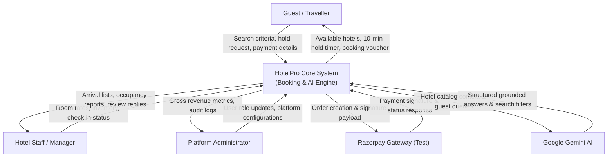
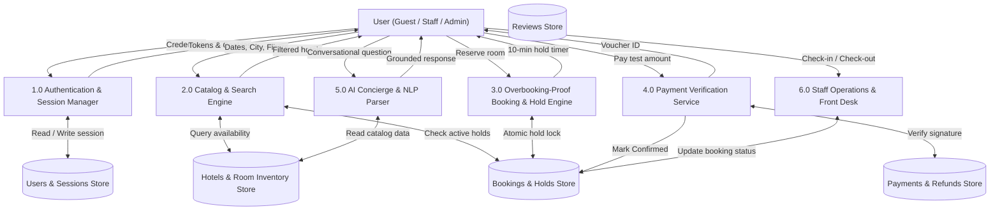

# Phase 3: Requirement Analysis Phase
## Data Flow Diagram (DFD) & User Stories

| Metadata | Details |
|---|---|
| **Date** | 20 October 2026 |
| **Team ID** | HP-TEAM-2026 |
| **Project Name** | HotelPro — Hotel Booking and Management Platform with AI Assistant |
| **Maximum Marks** | 4 Marks |

---

### 1. Data Flow Diagrams (DFD)

A Data Flow Diagram illustrates how information enters, flows through, and is persisted across the HotelPro platform. It captures user interactions, internal processing engines, and persistent data stores.

#### 1.1 DFD Level 0: Context Level Diagram

#### 1.2 DFD Level 1: Subsystem Breakdown

---

### 2. Comprehensive User Story Table

| User Type | Functional Requirement (Epic) | User Story / Task | Acceptance Criteria | Priority | Release |
|---|---|---|---|---|---|
| **Guest** | User Authentication | As a new guest, I want to create an account with my email and password so I can book rooms and view history. | Password meets 8-character rule (Aa1); duplicate email blocked with friendly message; returns JWT and session cookie. | High | Sprint-1 |
| **Guest** | User Authentication | As a guest, I want my active session to refresh automatically without interrupting my booking flow. | Expired 15-minute access token is refreshed silently using httpOnly cookie via Axios interceptor. | High | Sprint-1 |
| **Guest** | Hotel Search | As a traveller, I want to search hotels by destination city, stay dates, and guest count. | Only hotels with real vacant rooms for the selected dates are returned; date validation blocks past dates. | High | Sprint-2 |
| **Guest** | Hotel Search & Filter | As a traveller, I want to filter hotels by maximum price, star rating, and amenities like swimming pool and pet-friendly. | Instant UI filtering; search criteria preserved in URL query parameters so links can be bookmarked or shared. | High | Sprint-2 |
| **Guest** | Hotel Details | As a traveller, I want to view room categories with photos, bed configurations, inclusions, and house policies. | Displays gallery thumbnails, check-in/out hours, verified cancellation policies, and vacant room counts. | High | Sprint-2 |
| **Guest** | Booking & Hold Engine | As a guest, I want my selected room to be held for 10 minutes while I complete payment so nobody else books it. | Room availability immediately decrements; visible countdown timer starts; auto-releases if not paid in 10 minutes. | Critical | Sprint-3 |
| **Guest** | Concurrency Safety | As a guest, I want guaranteed protection against overbooking even if multiple people click "Book" simultaneously. | Under 20 simultaneous requests for the last room, exactly 1 booking succeeds and others receive friendly alert. | Critical | Sprint-3 |
| **Guest** | Transparent Pricing | As a guest, I want an itemized price breakdown showing base tariff, nights count, and 12% GST before paying. | Calculated strictly on server; shows nights × base price + 12% GST - coupon discount; matches final payment. | High | Sprint-3 |
| **Guest** | Payments | As a guest, I want to complete payment using Razorpay in test mode and receive a reference number and voucher. | Test checkout opens with prefilled details; signature verified on server; generates `HP-YYYY-XXXXXX` reference. | Critical | Sprint-3 |
| **Guest** | My Bookings & Cancellation | As a guest, I want to cancel an upcoming booking and receive an automated refund based on the hotel policy. | Cancellation policy enforced: >48h gives 100%, 24-48h gives 50%, <24h gives 0%; status updates to `Cancelled`. | High | Sprint-3 |
| **Guest** | Verified Reviews | As a guest who completed a stay, I want to submit a 1-to-5 star rating and review. | Form is accessible only for bookings with status `Completed`; updates hotel average rating automatically. | Medium | Sprint-4 |
| **Hotel Staff** | Front-Desk Operations | As a hotel manager, I want to view daily guest arrivals and mark guests as Checked-in and Checked-out. | Staff dashboard lists hotel reservations; status transitions `Confirmed` -> `Checked-in` -> `Completed`. | High | Sprint-4 |
| **Hotel Staff** | Review Moderation | As a hotel manager, I want to publicly reply to reviews written by guests who stayed at my property. | Reply appears beneath the verified guest review on the public hotel details page. | Medium | Sprint-4 |
| **Admin** | Platform Governance | As an administrator, I want to monitor gross platform revenue, total bookings count, and manage user roles. | Executive dashboard displays KPI cards, top hotels table, and user role management controls. | High | Sprint-4 |
| **User (All)** | AI Concierge | As a user, I want an AI assistant that answers specific hotel questions using real property catalog records. | Answers questions accurately using RAG on catalog data; provides honest answers about pools, pets, and rates. | High | Sprint-4 |
