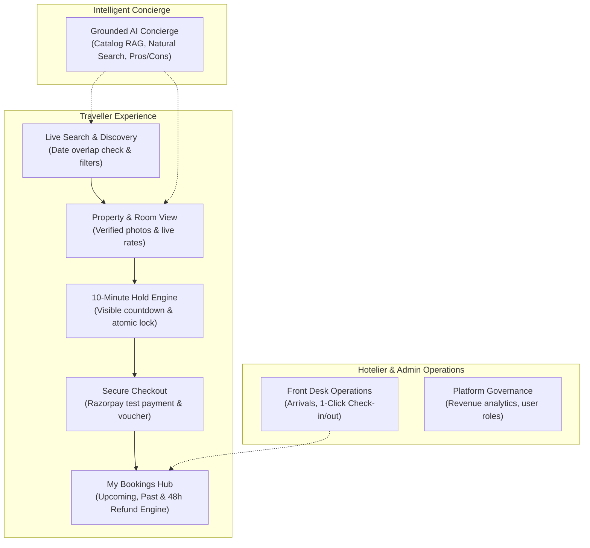

# Phase 4: Project Design Phase
## Proposed Solution

| Metadata | Details |
|---|---|
| **Date** | 20 October 2026 |
| **Team ID** | HP-TEAM-2026 |
| **Project Name** | HotelPro — Hotel Booking and Management Platform with AI Assistant |
| **Maximum Marks** | 2 Marks |

---

### 1. Executive Summary of Proposed Solution
HotelPro is an end-to-end, commercial-grade hospitality platform designed to solve the critical vulnerabilities of conventional travel portals. By pairing an **overbooking-proof reservation engine** with **transparent server-side pricing**, **Razorpay test payment workflows**, and an **integrated RAG AI Concierge**, HotelPro delivers a dependable, modern experience for guests while offering independent hoteliers intuitive front-desk controls.

---

### 2. Core Solution Pillars & Modules

#### Module 1: Overbooking-Proof Reservation & Hold Engine
- **Atomic Pre-Payment Hold**: When a traveller initiates checkout, the requested room is assigned a `Pending` state and decrements available inventory for exactly 10 minutes.
- **Visible Countdown Indicator**: A real-time timer informs the user of their reserved window, relieving anxiety while fetching payment credentials.
- **Automatic Hold Expiration**: A server background routine checks every 60 seconds and releases expired holds back to the public pool without manual intervention.
- **Concurrency Integrity**: Evaluated to guarantee that simultaneous requests for the final available room result in exactly one confirmed reservation.

#### Module 2: Transparent Financial Transactions & Payments
- **Authoritative Server Pricing**: The frontend never calculates the payable amount. Subtotals, stay duration, 12% statutory GST, and promotional coupon discounts are computed strictly on the backend.
- **Razorpay Sandbox Integration**: Provides a complete simulation of Indian digital payment methods (UPI apps, debit/credit cards, net banking) with HMAC-SHA256 signature verification.
- **Automated Cancellation Engine**: Enforces policy-based refunds:
  - More than 48 hours before check-in: **100% full refund**.
  - Between 24 and 48 hours: **50% partial refund**.
  - Under 24 hours: **0% non-refundable**.

#### Module 3: Grounded AI Concierge (RAG Architecture)
- **Zero Hallucination Guardrails**: Powered by Google Gemini (`gemini-1.5-flash`), the assistant answers user inquiries regarding amenities, pet policies, child extra beds, and check-in hours by querying real hotel database records.
- **Natural Language Filter Extraction**: Converts human travel sentences (e.g. *"I need a pet friendly resort in Goa with a pool under 6000"*) directly into structured URL search filters.
- **AI Review Synthesis**: Analyzes dozens of guest feedback entries to generate a 2-sentence summary with top pros and potential cons.

#### Module 4: Hotelier & Staff Portal
- **Streamlined Operations**: A lightweight web interface built for small and mid-sized hotel front desks, displaying daily arrivals and room occupancy.
- **1-Click Status Transitions**: Easily toggle guest reservations between `Confirmed`, `Checked-in`, and `Completed`.
- **Review Engagement**: Enables hotel managers to publicly respond to verified reviews.

#### Module 5: Platform Administration & Analytics
- **Executive Analytics**: Real-time KPI dashboards visualizing gross platform revenue, total bookings count, average occupancy rates, and top revenue-generating properties.
- **Role-Based Access Control (RBAC)**: Enforces access restrictions across `guest`, `staff`, and `admin` roles, with brute-force account locking after 5 failed password attempts.
