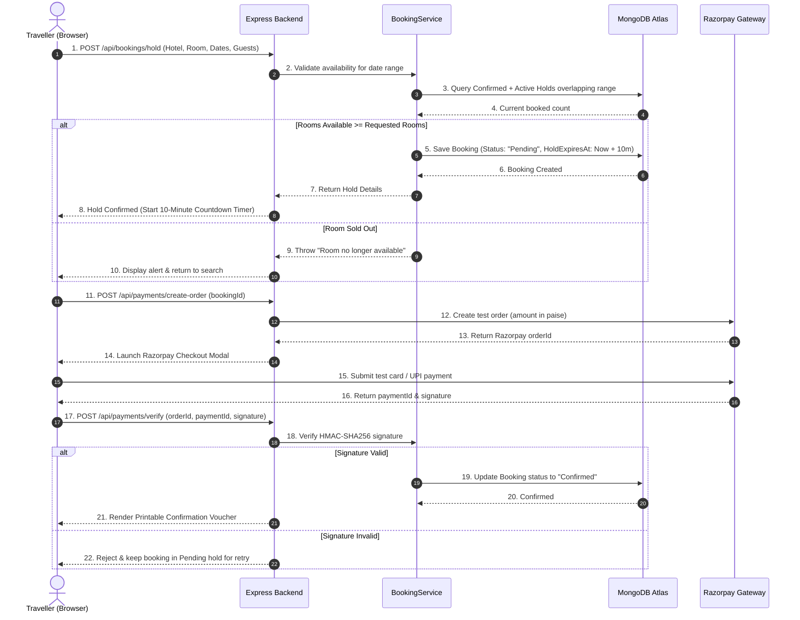

# Phase 4: Project Design Phase
## Solution Architecture

| Metadata | Details |
|---|---|
| **Date** | 20 October 2026 |
| **Team ID** | HP-TEAM-2026 |
| **Project Name** | HotelPro — Hotel Booking and Management Platform with AI Assistant |
| **Maximum Marks** | 4 Marks |

---

### 1. Architectural Blueprint
The HotelPro solution is structured as a decoupled, layered **3-Tier Architecture** that enforces clean separation of concerns, high concurrency resilience, and end-to-end data integrity.

```mermaid
graph TD
    subgraph Tier 1: Presentation Layer (Client)
        ReactApp["React 18 Single Page Application\n(Vite + Tailwind CSS + Lucide Icons)"]
        Router["React Router v7 Navigation"]
        Context["Auth & Booking Context Providers"]
        AxiosClient["Axios HTTP Client\n(with 401 Silent Refresh Interceptors)"]
        
        ReactApp --> Router
        Router --> Context
        Context --> AxiosClient
    end
    
    subgraph Tier 2: Business Logic & Application Layer (Node.js API)
        ExpressServer["Express.js HTTP Web Server\n(Port 5001 / Helmet / CORS)"]
        
        AuthMW["Authentication & Role Guard\n(JWT Verify + Role Check)"]
        ZodMW["Zod Request Validation Middleware"]
        
        HotelCtrl["Hotel & Search Controller"]
        BookingCtrl["Booking & Hold Controller"]
        PaymentCtrl["Razorpay Payment Controller"]
        StaffCtrl["Staff Operations Controller"]
        AdminCtrl["Admin Analytics Controller"]
        AICtrl["Gemini AI Concierge Controller"]
        
        BookingSvc["BookingService\n(Concurrency Overlap Engine & Holds)"]
        PaymentSvc["PaymentService\n(HMAC-SHA256 Signature Verification)"]
        AISvc["AIService\n(Grounded RAG & NLP Filter Parser)"]
        
        ExpressServer --> AuthMW --> ZodMW
        ZodMW --> HotelCtrl
        ZodMW --> BookingCtrl
        ZodMW --> PaymentCtrl
        ZodMW --> StaffCtrl
        ZodMW --> AdminCtrl
        ZodMW --> AICtrl
        
        BookingCtrl --> BookingSvc
        PaymentCtrl --> PaymentSvc
        AICtrl --> AISvc
    end
    
    subgraph Tier 3: Persistence & External Cloud Layer
        MongoDB[("MongoDB Atlas Database\n(Mongoose ODM - Users, Hotels, Bookings, Sessions)")]
        RazorpayGateway["Razorpay Sandbox Gateway\n(Order Creation & Signature Verification)"]
        GoogleGemini["Google Gemini AI Platform\n(gemini-1.5-flash API)"]
        
        BookingSvc <-->|Atomic Transactions & Overlap Queries| MongoDB
        HotelCtrl <-->|Indexed Catalog Lookups| MongoDB
        AdminCtrl <-->|Aggregation Pipelines| MongoDB
        
        PaymentSvc <-->|API Calls & Signature Payloads| RazorpayGateway
        AISvc <-->|Context Grounding & Prompt Payloads| GoogleGemini
    end
    
    AxiosClient -->|HTTPS REST API Calls & httpOnly Cookies| ExpressServer
```

---

### 2. Layer Responsibilities & Component Details

#### 2.1 Presentation Layer (Frontend)
- **Framework**: React 18 powered by Vite for rapid development and sub-second asset bundling.
- **Styling**: Tailwind CSS providing a responsive, accessible, mobile-first design.
- **State Management & Context**: `AuthContext` managing user authentication, silent session renewal, and automatic role checking; local state managing search filters, booking details, and countdown timers.
- **Axios Interceptors**: Automatically attaches the Bearer access token to request headers and intercepts `401 Unauthorized` responses to perform transparent silent token renewal using the httpOnly refresh cookie.

#### 2.2 Application Layer (Backend API)
- **Controller Layer**: Decoupled HTTP handlers responsible for parsing requests and sending standardized API responses (`sendSuccess`, `sendError`).
- **Validation Layer**: Zod schemas validate request parameters, preventing SQL/NoSQL injection, negative stay durations, or unauthorized role assignments.
- **Service Layer**:
  - `BookingService`: Implements date overlap availability formula, atomic hold creation, hold expiration cleanup, and 48h/24h refund tier calculations.
  - `PaymentService`: Communicates with Razorpay SDK, generates test order receipts, and validates cryptographic signatures using `crypto.createHmac('sha256', secret)`.
  - `AIService`: Assembles live catalog summaries and constructs system prompts enforcing zero-hallucination guardrails before invoking Google Gemini.

#### 2.3 Persistence & External Layer
- **MongoDB Atlas**: Fully managed document database utilizing indexes on `city`, `starRating`, `pricePerNight`, and compound indexes on `roomTypeId`, `status`, `checkIn`, and `checkOut` for rapid availability queries.
- **Razorpay Sandbox**: Provides real-world payment simulation (Cards, Net Banking, UPI) without transferring real funds.
- **Google Gemini**: Provides conversational AI grounded in HotelPro's verified property catalog.

---

### 3. Key Transaction Flow: Overbooking-Proof Hold & Confirmation


